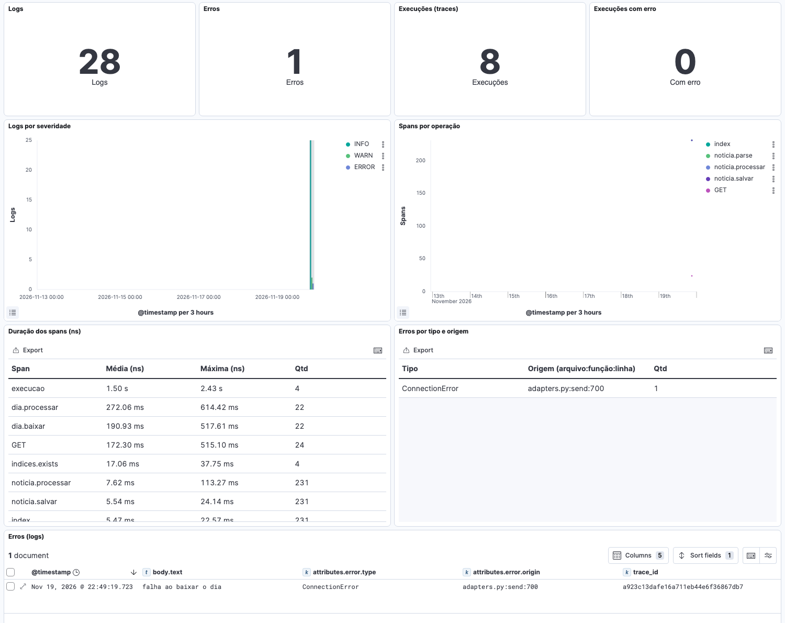
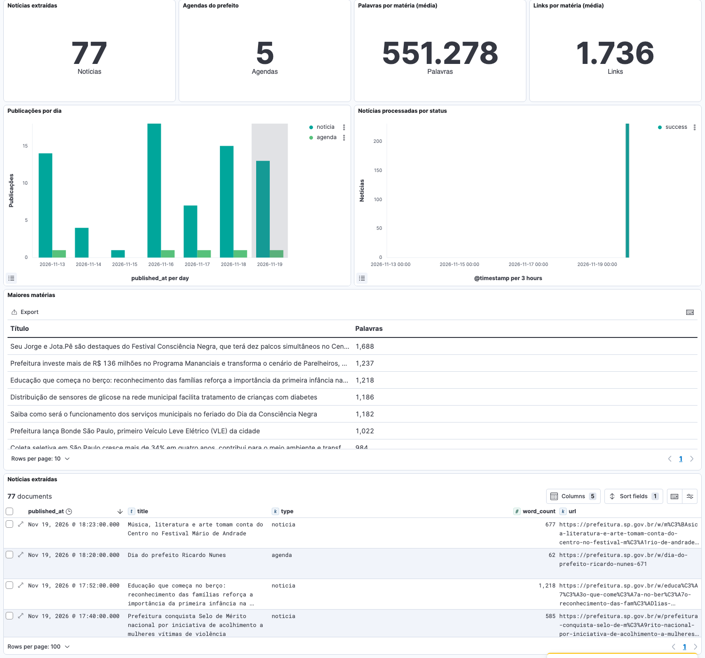
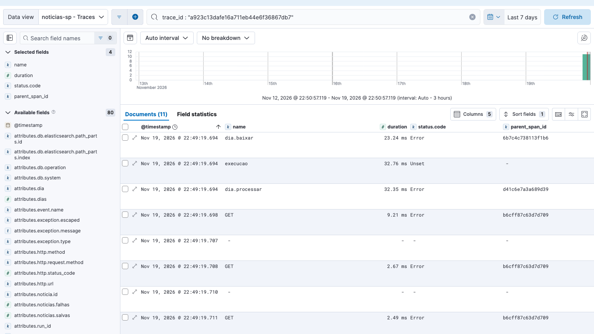

# obskit — observabilidade para automações Python

[](https://github.com/pedrowill-dev/obskit/actions/workflows/ci.yml)

Logs, traces e métricas de qualquer projeto Python (RPA, scrapers, jobs, APIs) num dashboard do Kibana,
com **dois comandos** e **três linhas de código**. Tudo roda local, em Docker, sobre padrões abertos:
[OpenTelemetry](https://opentelemetry.io/) → Elasticsearch → Kibana.

```bash
pip install obskit
obskit init     # cria observability/ (stack + dashboard base) no seu projeto
obskit up       # sobe Elasticsearch, Kibana e Collector e cria o dashboard
```

```python
import logging, obskit

log = logging.getLogger(__name__)
shutdown = obskit.setup("meu-servico")      # logs + traces + métricas

@obskit.traced()                             # um span por chamada
def processar(item): ...

try:
    processar(x)
except Exception:
    log.exception("falhou")                  # sai com error.type, error.origin e error.chain

shutdown()                                   # descarrega os dados pendentes
```

Abra http://localhost:5601 → *Dashboards* → `meu-servico - Observabilidade`.

## Como fica

Saúde do robô — logs, erros por tipo e origem, duração de cada operação, tudo gerado pelo `obskit init`:



Dados de negócio no mesmo dashboard (exemplo: notícias da Prefeitura de SP extraídas e gravadas no Elasticsearch):



De um erro ao trace completo, pelo `trace_id` — veja qual operação falhou e quanto cada uma levou:



## O que você ganha

- **Dashboard pronto** com logs por severidade, erros por tipo e origem (`arquivo:função:linha`), execuções,
  duração de cada operação (spans) e a lista de erros com o `trace_id` para investigar.
- **Erros rastreáveis**: todo `log.exception(...)` carrega a cadeia de chamadas até o ponto onde a falha nasceu.
- **Dashboard como código**: evolua no Kibana, rode `obskit dashboard export` e versione o arquivo no git;
  qualquer máquina recria tudo com `obskit up`.
- **Seus dados no mesmo lugar**: o robô grava o que extrai no Elasticsearch e o dashboard mistura saúde do robô
  com os dados de negócio (veja o exemplo das notícias).

## Estrutura do repositório

| Pasta | O que é |
|---|---|
| [`obskit/`](obskit) | A biblioteca + CLI (pacote Python instalável) |
| [`exemplo-noticias-sp/`](exemplo-noticias-sp) | Exemplo completo: extrai as notícias de [prefeitura.sp.gov.br/noticias](https://prefeitura.sp.gov.br/noticias) |
| [`exemplo-wikipedia/`](exemplo-wikipedia) | Primeiro protótipo (antes do `obskit`): robô de artigos da Wikipedia com a stack montada à mão |
| [`docs/`](docs) | Documentação detalhada |
| [`error/`](error) | Script original de diagnóstico de erros que inspirou o `error.chain` |

## Documentação

1. [Início rápido](docs/inicio-rapido.md) — do zero ao dashboard em 5 minutos
2. [Guia do obskit](docs/guia-obskit.md) — referência da CLI e da biblioteca
3. [Dashboards](docs/dashboards.md) — o que cada painel mostra, como criar os seus e versioná-los
4. [Arquitetura](docs/arquitetura.md) — como os dados fluem e por que foi montado assim
5. [Solução de problemas](docs/solucao-de-problemas.md)
6. [Exemplo: notícias da Prefeitura de SP](exemplo-noticias-sp/README.md)
7. [Contribuindo](CONTRIBUTING.md)

## Requisitos

- Python 3.10+
- Docker com Compose v2 (no macOS: Docker Desktop ou [Colima](https://github.com/abiosoft/colima))
- ~2 GB de RAM livres para o Elasticsearch

## Instalação a partir do GitHub

Enquanto o pacote não está no PyPI:

```bash
pip install "obskit[requests] @ git+https://github.com/pedrowill-dev/obskit.git#subdirectory=obskit"
```

Ou, num clone local: `pip install -e "./obskit[requests]"`.
O extra `requests` adiciona um span automático para cada chamada HTTP feita com a biblioteca `requests`.

## Segurança

A stack gerada é para **ambiente local de desenvolvimento**: a segurança do Elasticsearch está desligada e as portas
são publicadas apenas em `127.0.0.1`. Não exponha essa stack na rede nem a use em produção sem habilitar
autenticação e TLS.

## Licença

Defina a licença do projeto antes de publicar (ex.: adicione um arquivo `LICENSE`).
