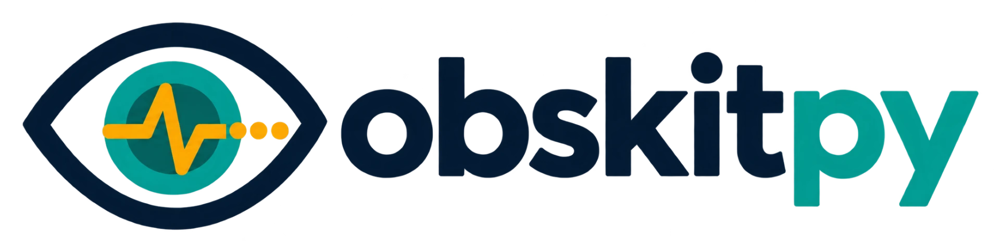
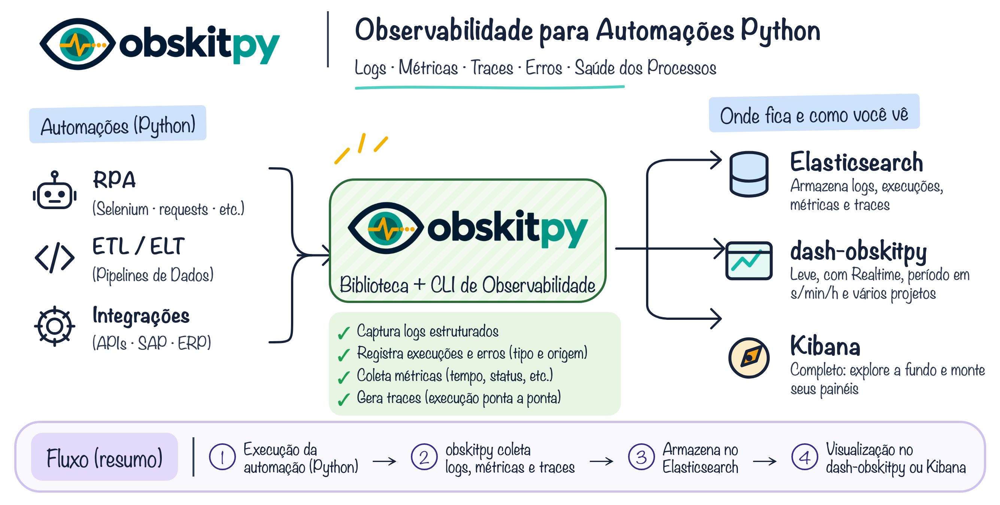
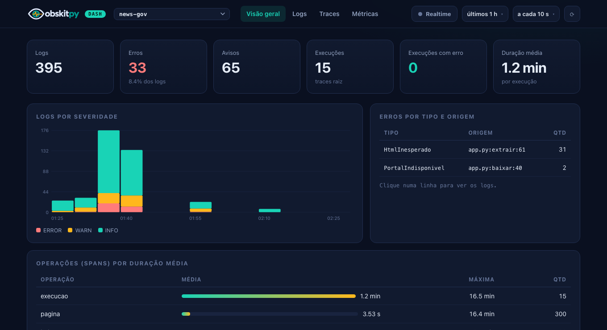
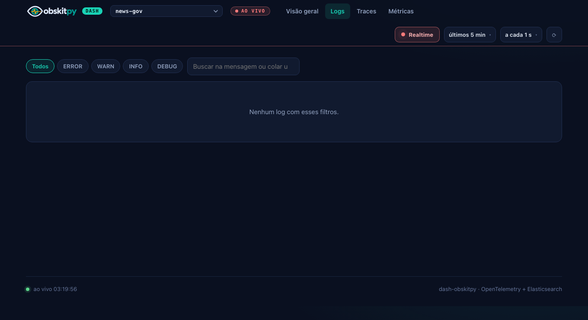

<h1 align="center"></h1>

<p align="center"><b>Observabilidade para automações Python</b> — OpenTelemetry → Elasticsearch → dash-obskitpy ou Kibana, via CLI</p>

[](https://github.com/pedrowill-dev/obskitpy/actions/workflows/ci.yml)

Logs, traces e métricas de qualquer projeto Python (RPA, scrapers, jobs, APIs) num dashboard, com
**dois comandos** e **três linhas de código**. **Você escolhe onde visualizar**: o **dash-obskitpy** (leve, próprio,
sem Kibana) ou o **Kibana** (completo), ou os dois. Tudo roda local, em Docker, sobre padrões abertos:
[OpenTelemetry](https://opentelemetry.io/) → Elasticsearch → dash-obskitpy / Kibana.

```bash
uv add "obskitpy[requests]"      # ou: pip install "obskitpy[requests]"
uv run obskitpy init     # assistente: escolhe onde visualizar, sobe a stack e roda um exemplo
```


Sem terminal interativo (scripts, CI), escolha por flags: `obskitpy init --local dash-obskitpy --yes --up --demo`
(`--local kibana`, `dash-obskitpy` ou `ambos`).

```python
import logging, obskitpy

log = logging.getLogger(__name__)
shutdown = obskitpy.setup("meu-servico")      # logs + traces + métricas

@obskitpy.traced()                             # um span por chamada
def processar(item): ...

try:
    processar(x)
except Exception:
    log.exception("falhou")                  # sai com error.type, error.origin e error.chain

shutdown()                                   # descarrega os dados pendentes
```

Abra o dashboard com `obskitpy open`: **dash-obskitpy** em http://localhost:8600 ou, no Kibana,
http://localhost:5601 → *Dashboards* → `meu-servico - Observabilidade`.

## Como funciona



1. Sua automação (RPA, ETL, integração) roda como sempre e chama `obskitpy.setup("meu-servico")`.
2. O obskitpy captura **logs, métricas e traces** (e os erros, com tipo e origem) e envia por OpenTelemetry.
3. Tudo é gravado no **Elasticsearch** local (Docker).
4. Você visualiza no **dash-obskitpy** (leve, com Realtime) ou no **Kibana** (completo) — você escolhe no `obskitpy init`.

Vários projetos podem usar a **mesma stack**: o `init` detecta uma stack já rodando e pergunta se você quer incluir a nova automação nela; no dash, um seletor no topo troca de projeto.

## Como fica

**dash-obskitpy** — o dashboard próprio, leve e sem Kibana:



Período e atualização editáveis (segundos, minutos, horas) e o atalho **Realtime** (`obskitpy open --realtime`) para ver os logs ao vivo:



**Kibana** — saúde do robô — logs, erros por tipo e origem, duração de cada operação, dashboard base gerado pelo `obskitpy init`:


Dados de negócio no mesmo dashboard (exemplo: notícias da Prefeitura de SP extraídas e gravadas no Elasticsearch):


De um erro ao trace completo, pelo `trace_id` — veja qual operação falhou e quanto cada uma levou:


## O que você ganha

- **Dashboard pronto** com logs por severidade, erros por tipo e origem (`arquivo:função:linha`), execuções,
  duração de cada operação (spans) e a lista de erros com o `trace_id` para investigar.
- **Erros rastreáveis**: todo `log.exception(...)` carrega a cadeia de chamadas até o ponto onde a falha nasceu.
- **Dashboard como código**: evolua no Kibana, rode `obskitpy dashboard export` e versione o arquivo no git;
  qualquer máquina recria tudo com `obskitpy up`.
- **Seus dados no mesmo lugar**: o robô grava o que extrai no Elasticsearch e o dashboard mistura saúde do robô
  com os dados de negócio (veja o exemplo das notícias).

## Estrutura do repositório

| Pasta | O que é |
|---|---|
| [`obskitpy/`](obskitpy) | A biblioteca + CLI (pacote Python instalável) |
| [`exemplo-noticias-sp/`](exemplo-noticias-sp) | Exemplo completo: extrai as notícias de [prefeitura.sp.gov.br/noticias](https://prefeitura.sp.gov.br/noticias) |
| [`exemplo-wikipedia/`](exemplo-wikipedia) | Primeiro protótipo (antes do `obskitpy`): robô de artigos da Wikipedia com a stack montada à mão |
| [`docs/`](docs) | Documentação detalhada |
| [`error/`](error) | Script original de diagnóstico de erros que inspirou o `error.chain` |

## Documentação

📖 **Site de documentação:** https://pedrowill-dev.github.io/obskitpy/

1. [Início rápido](docs/inicio-rapido.md) — do zero ao dashboard em 5 minutos
2. [Guia do obskitpy](docs/guia-obskitpy.md) — referência da CLI e da biblioteca
   - [dash-obskitpy](docs/dash-obskitpy.md) — o dashboard próprio e como escolher onde visualizar
3. [Dashboards](docs/dashboards.md) — o que cada painel mostra, como criar os seus e versioná-los
4. [Arquitetura](docs/arquitetura.md) — como os dados fluem e por que foi montado assim
5. [Solução de problemas](docs/solucao-de-problemas.md)
6. [Exemplo: notícias da Prefeitura de SP](exemplo-noticias-sp/README.md)
7. [Publicando no PyPI](docs/publicando.md) — para mantenedores
8. [Contribuindo](CONTRIBUTING.md)

## Requisitos

- Python 3.10+
- Docker com Compose v2 (no macOS: Docker Desktop ou [Colima](https://github.com/abiosoft/colima))
- ~2 GB de RAM livres para o Elasticsearch

## Instalação a partir do GitHub

### Com [uv](https://docs.astral.sh/uv/) (recomendado)

```bash
uv add "obskitpy[requests]"        # adiciona ao seu projeto
uv run obskitpy init               # a CLI roda no ambiente do projeto
uvx obskitpy --help                # ou use a CLI sem instalar nada
```

### Com pip

```bash
pip install "obskitpy[requests]"
```

### Direto do GitHub (versão em desenvolvimento)

```bash
uv add "obskitpy[requests] @ git+https://github.com/pedrowill-dev/obskitpy.git#subdirectory=obskitpy"
pip install "obskitpy[requests] @ git+https://github.com/pedrowill-dev/obskitpy.git#subdirectory=obskitpy"
```

Num clone local: `pip install -e "./obskitpy[requests]"`.
O extra `requests` adiciona um span automático para cada chamada HTTP feita com a biblioteca `requests`.

## Segurança

A stack gerada é para **ambiente local de desenvolvimento**: a segurança do Elasticsearch está desligada e as portas
são publicadas apenas em `127.0.0.1`. Não exponha essa stack na rede nem a use em produção sem habilitar
autenticação e TLS.

## Licença

[MIT](LICENSE) © 2026 Pedro França.
