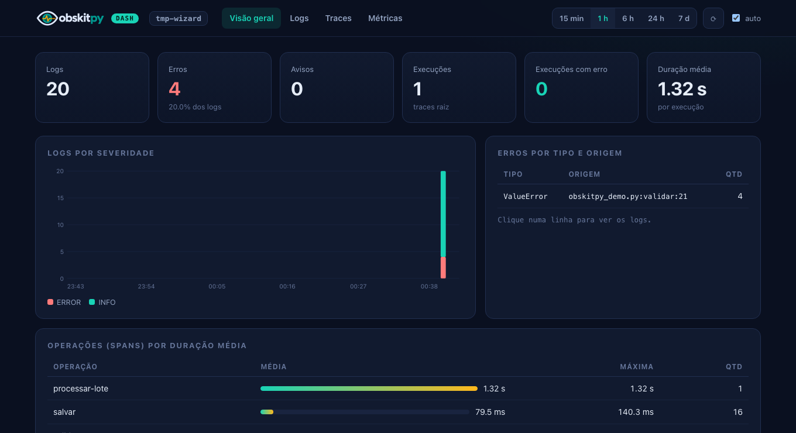
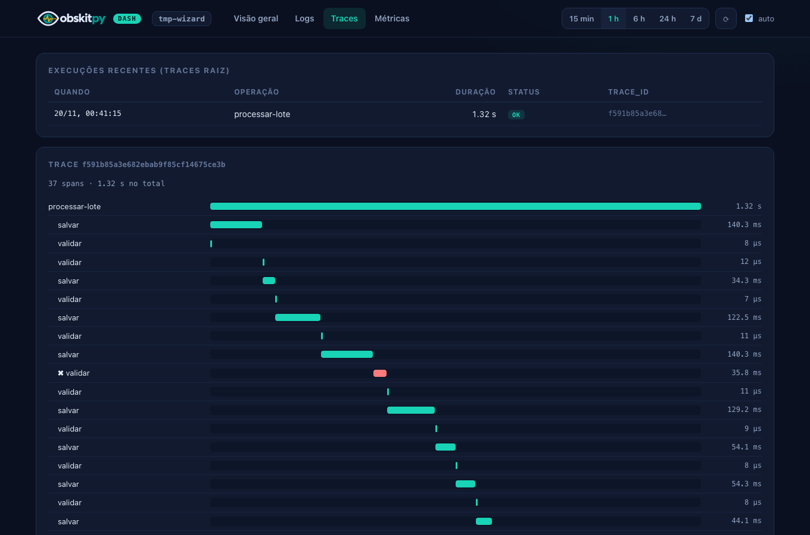

# dash-obskitpy

O **dash-obskitpy** é o dashboard próprio do obskitpy: leve, direto ao ponto e sem Kibana. Ele roda como um
container `nginx` que serve uma página estática (HTML, CSS e JavaScript puros) e conversa com o Elasticsearch
por um proxy **somente leitura**.



## Escolhendo onde visualizar

Você decide no `obskitpy init`, pelo menu ou pela flag `--local`:

| `--local` | O que sobe | Quando usar |
|---|---|---|
| `kibana` (padrão sem terminal) | Elasticsearch, Collector, Kibana | Explorar a fundo, montar painéis próprios e consultas livres. |
| `dash-obskitpy` | Elasticsearch, Collector, dash | O dia a dia: ver erros, tempos e execuções logo, gastando menos memória e subindo mais rápido. |
| `ambos` | Tudo | dash para olhar rápido e Kibana para investigar a fundo. O dash ganha um atalho "Kibana ↗". |

```bash
obskitpy init --local dash-obskitpy
obskitpy up
obskitpy open        # abre em http://localhost:8600
```

Mudou de ideia? `obskitpy init --force --local ambos` recria a configuração (os dados no Elasticsearch continuam).

## O que o dash mostra

O período fica no canto superior direito (15 min, 1 h, 6 h, 24 h ou 7 d) e a atualização é automática a cada
10 s (dá para desligar em *auto*). Os dados são sempre filtrados pelo seu serviço.

### Visão geral

Contadores (logs, erros, avisos, execuções, execuções com erro, duração média), **logs por severidade** ao longo
do tempo, **erros por tipo e origem** (`arquivo:função:linha`) e as **operações por duração média**.
Clique num erro para abrir os logs já filtrados.

### Logs

Os 100 registros mais recentes com filtro por nível (ERROR, WARN, INFO, DEBUG) e busca por texto na mensagem.
Cole um `trace_id` na busca para ver só os logs daquela execução. Clique numa linha para abrir os atributos,
o stack trace e o botão **Ver trace completo**.

### Traces

As execuções recentes (spans raiz) e, ao clicar numa delas, o **waterfall**: cada span na ordem da hierarquia,
com a barra de duração na linha do tempo e as falhas em vermelho.



O endereço guarda o trace (`#traces/<trace_id>`), então dá para compartilhar o link com quem usa a mesma máquina.

### Métricas

Escolha qualquer métrica criada com `obskitpy.meter(...)`; o gráfico soma os valores no tempo, separados pelo
atributo `status` quando existir (`success` e `failure`, por exemplo).

## Como funciona

```
navegador ──▶ nginx :8600 ──▶ /            página estática (dash/)
                         └──▶ /es/...      proxy ──▶ Elasticsearch (só _search, _count e _field_caps)
```

- Nada de backend próprio: a página faz as consultas de agregação direto no Elasticsearch.
- O `nginx.conf` libera apenas `_search`, `_count` e `_field_caps`; qualquer outra rota de `/es/` responde 403.
- A porta é publicada só em `127.0.0.1`, como o resto da stack.

## Personalizando

Os arquivos ficam em `observability/dash/` e são seus (versione no git): `index.html`, `style.css`, `app.js`
e `config.js` (que traz o nome do serviço). Edite à vontade; o `nginx` serve a pasta como está, então basta
recarregar a página.

!!! note "Qual escolher?"
    Está começando ou só quer saber se o robô está bem? Use o **dash-obskitpy**.
    Precisa cruzar dados, montar visualizações novas ou guardar dashboards versionados? Use o **Kibana**
    (veja [Dashboards](dashboards.md)).
