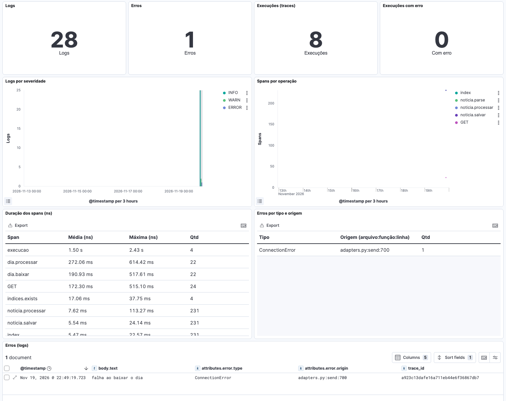
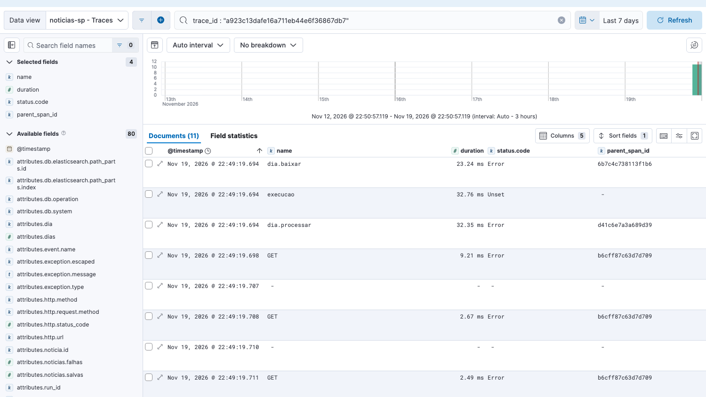
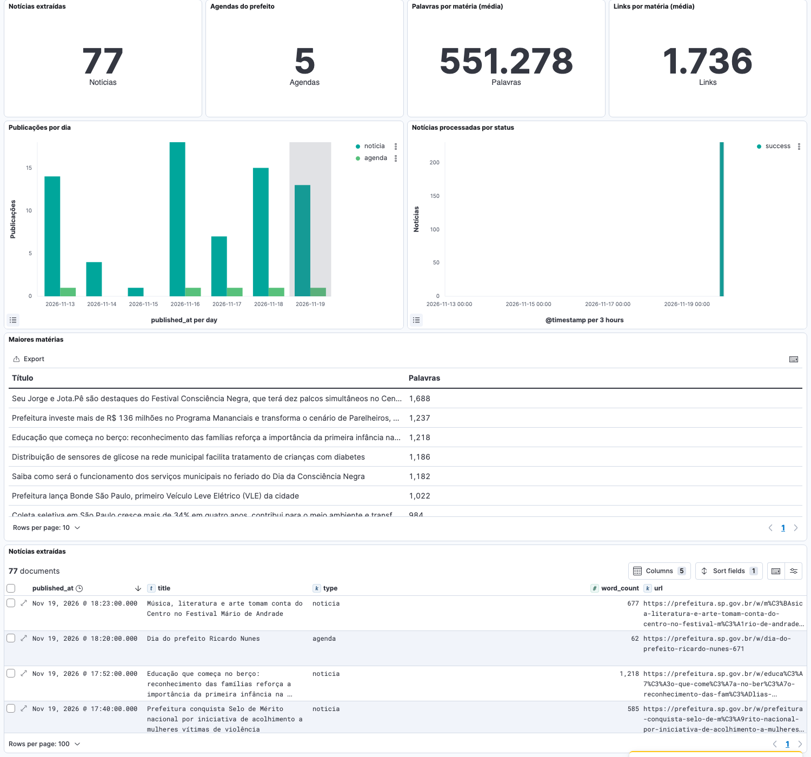

# Dashboards

## O dashboard base

O `obskitpy init` gera o dashboard `<servico>-observability` (id fixo, então reimportar sobrescreve em vez de duplicar).
Todos os painéis filtram por `resource.attributes.service.name : "<servico>"`.

| Painel | Fonte | O que mostra |
|---|---|---|
| Logs / Erros | logs | Total de logs e de logs com `severity_text: ERROR`. |
| Execuções (traces) | traces | Spans raiz (cada execução de ponta a ponta). |
| Execuções com erro | traces | Spans raiz com `status.code: Error` — só conta falhas que derrubam a execução inteira; falhas tratadas aparecem em *Erros*. |
| Logs por severidade | logs | Volume ao longo do tempo, por INFO/WARN/ERROR. |
| Spans por operação | traces | Quantidade de spans por nome, ao longo do tempo. |
| Duração dos spans | traces | Média, máxima e quantidade por operação (em ns, o Kibana formata como ms/s). |
| Erros por tipo e origem | logs | `error.type` × `error.origin` (`arquivo:função:linha`) com contagem. |
| Erros (logs) | logs | Busca salva com os erros, `body.text`, tipo, origem e `trace_id`. |



### Investigando um erro

1. No painel **Erros (logs)** ou em **Erros por tipo e origem**, identifique o tipo e a origem.
2. Copie o `trace_id` da linha do erro.
3. No *Discover*, escolha a data view `<servico> - Traces` e filtre por `trace_id : "<id>"`:
   você vê todos os spans daquela execução, com duração e qual deles falhou.

   

   Os spans com `status.code: Error` mostram onde a falha ocorreu (aqui, `GET` → `dia.baixar` → `dia.processar`).
4. Abra o documento do log para ver `error.chain` (cadeia de chamadas) e `exception.stacktrace`.

## Evoluindo o dashboard

Há dois caminhos. Escolha **um** por projeto para não sobrescrever o trabalho do outro.

### A) Pelo Kibana (mais simples)

1. Abra o dashboard → **Edit** → adicione ou ajuste painéis (Lens, TSVB, buscas salvas…) → **Save**.
2. Grave no repositório:
   ```bash
   obskitpy dashboard export
   git add observability/dashboard.ndjson && git commit -m "dashboard: novo painel X"
   ```
3. Em outra máquina ou no CI, `obskitpy up` (ou `obskitpy dashboard apply`) recria o dashboard idêntico.

O `export` inclui o dashboard e tudo que ele referencia (visualizações, buscas, data views).

### B) Por código (revisável em pull request)

Gere o `dashboard.ndjson` por um script Python partindo do dashboard base — o
[exemplo das notícias](../exemplo-noticias-sp/observability/extend_dashboard.py) faz isso:

```python
from obskitpy.dashboard import build, agg, metric_vis, chart_vis, table_vis, terms, date_histogram, ref, search_source

objects = build("meu-servico")          # painéis base do obskitpy
# ... acrescente data views, visualizações e painéis, ajustando o dashboard.panelsJSON e references
```

Depois: `python observability/extend_dashboard.py && obskitpy dashboard apply`.
O script regera o arquivo do zero; **não** rode `export` por cima, ou as edições feitas no Kibana substituem o script.

Helpers disponíveis em `obskitpy.dashboard`: `agg`, `terms`, `date_histogram`, `metric_vis`, `chart_vis`,
`table_vis`, `search_source`, `ref`, `build`, `to_ndjson`.

## Misturando dados de negócio



Se o robô grava o que extrai no Elasticsearch (como o exemplo das notícias grava em `noticias-sp`), crie uma data
view para esse índice e monte painéis ao lado dos de saúde. O resultado é um único dashboard que responde tanto
"o robô está saudável?" quanto "o que ele extraiu?".

## Dicas

- **Janela de tempo**: o dashboard guarda `now-24h`; o Kibana, porém, lembra a última janela que você usou no
  navegador. Para um link com janela fixa: `...#/view/<id>?_g=(time:(from:now-7d,to:now))`.
- **Data views**: o `init` cria `<servico> - Logs` e `<servico> - Traces` (padrões `logs-generic.otel-*` e
  `traces-generic.otel-*`). Para métricas, crie uma data view `metrics-generic.otel-*`.
- **Campos de data**: painéis sobre dados de negócio usam o campo de data do *seu* índice
  (`date_histogram(2, field="published_at")`).
