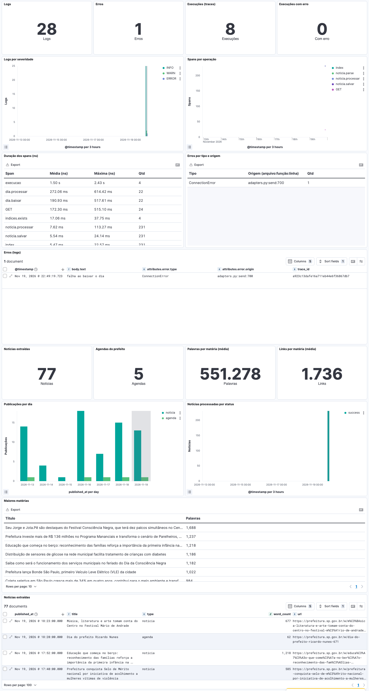
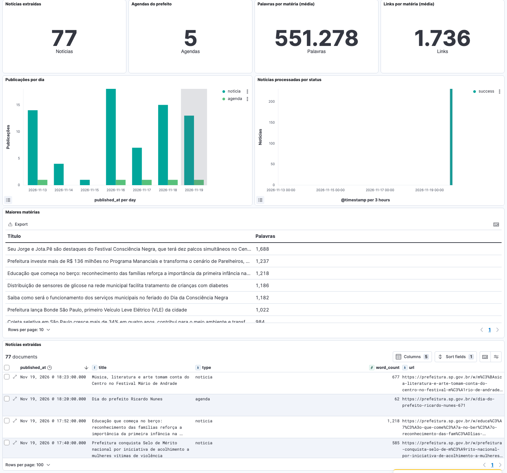

# Exemplo: notícias da Prefeitura de SP

Projeto completo que usa o obskitpy: um robô extrai as notícias de
[prefeitura.sp.gov.br/noticias](https://prefeitura.sp.gov.br/noticias), grava no Elasticsearch
(índice `noticias-sp`) e o dashboard mostra os dados extraídos **e** a saúde do robô.



O código está em [`exemplo-noticias-sp/`](https://github.com/pedrowill-dev/obskitpy/tree/main/exemplo-noticias-sp).

## Como os dados são obtidos

A lista "Todas as notícias" da página é montada no navegador por JavaScript, então o HTML vem sem notícias.
O robô chama a mesma API pública do portal (Liferay) que o JavaScript chama, um dia por vez.
Cada item vira um documento com título, URL, datas, resumo, texto, nº de palavras, links, imagens e tipo
(`noticia` ou `agenda` — a "Dia do prefeito" é a agenda diária). O id é o da Prefeitura, então rodar de novo
**atualiza** em vez de duplicar.

!!! note "Use com moderação"
    São cerca de 7 requisições por execução. Se o portal mudar a estrutura, o erro de parse aparece no dashboard.

## Rodar

```bash
git clone https://github.com/pedrowill-dev/obskitpy && cd obskitpy/exemplo-noticias-sp
python3 -m venv .venv && .venv/bin/pip install -r requirements.txt
.venv/bin/obskitpy up                      # stack + dashboard (~1 min na primeira vez)
.venv/bin/python -m noticias_sp            # extrai os últimos 7 dias
```

Dashboard: <http://localhost:5601/app/dashboards#/view/noticias-sp-observability?_g=(time:(from:now-7d,to:now))>

| Variável | Padrão | |
|---|---|---|
| `DIAS` | `7` | quantos dias para trás (contando hoje) |
| `RPA_INTERVAL_SECONDS` | `0` | `0` = roda uma vez; `>0` repete a cada N segundos |
| `ELASTICSEARCH_URL` | `http://localhost:9200` | |

## O que o obskitpy trouxe

Foi preciso só isto no código:

```python
shutdown = obskitpy.setup("noticias-sp")        # logs + traces + métricas
tracer = obskitpy.tracer("noticias_sp")         # spans: execucao > dia.processar > dia.baixar | noticia.processar
processed = obskitpy.meter("noticias_sp").create_counter("noticias.processadas")   # métrica própria, por status
log.exception("falha ao processar notícia")     # já sai com error.type / error.origin / error.chain
```

Os painéis do topo (logs, erros, execuções, duração, erros por tipo/origem) vêm do `obskitpy init`.
Os de baixo (notícias extraídas, publicações por dia, maiores matérias, tabela de notícias) são do projeto, em
[`extend_dashboard.py`](https://github.com/pedrowill-dev/obskitpy/blob/main/exemplo-noticias-sp/observability/extend_dashboard.py);
veja [Dashboards](dashboards.md#b-por-codigo-revisavel-em-pull-request).



## Limitações conhecidas

- A API não traz categorias das notícias, então não há painel por categoria.
- "Execuções com erro" só conta falhas que derrubam a execução inteira; falhas por dia/notícia são tratadas e aparecem em *Erros*.
- O horário de publicação é gravado em UTC; o robô consulta os dias no fuso de São Paulo (-03:00).
