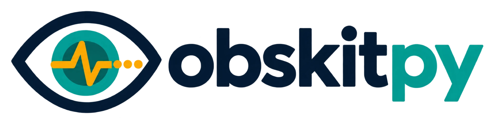
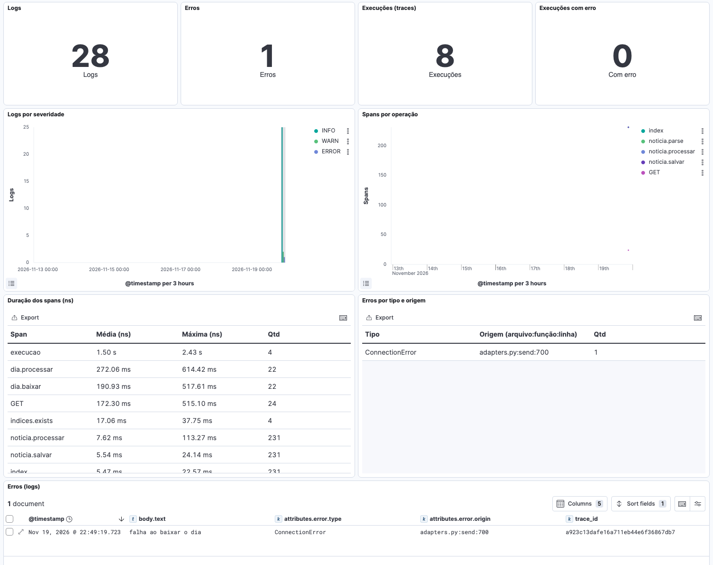

---
hide:
  - navigation
  - toc
---

<p align="center"></p>

<p align="center" markdown>
<b>Observabilidade para automações Python</b> em dois comandos e três linhas de código.<br>
Logs, traces e métricas do seu RPA, scraper ou job num dashboard do Kibana — local, em Docker, com padrões abertos.
</p>

<p align="center" markdown>
[Começar agora](inicio-rapido.md){ .md-button .md-button--primary }
[Ver no GitHub](https://github.com/pedrowill-dev/obskitpy){ .md-button }
</p>

## Em 1 minuto

=== "uv"

    ```bash
    uv add "obskitpy[requests]"
    uv run obskitpy init     # cria observability/ (stack + dashboard base)
    uv run obskitpy up       # sobe Elasticsearch, Kibana e Collector e cria o dashboard
    ```

=== "pip"

    ```bash
    pip install "obskitpy[requests]"
    obskitpy init
    obskitpy up
    ```

```python
import logging, obskitpy

log = logging.getLogger(__name__)
shutdown = obskitpy.setup("meu-servico")     # logs + traces + métricas

@obskitpy.traced()                            # um span por chamada
def processar(item): ...

try:
    processar(x)
except Exception:
    log.exception("falhou")                   # sai com error.type, error.origin e error.chain

shutdown()                                    # descarrega os dados pendentes
```

Abra <http://localhost:5601> → *Dashboards* → `meu-servico - Observabilidade`.



## O que você ganha

<div class="grid cards" markdown>

-   :material-view-dashboard: **Dashboard pronto**

    Logs por severidade, erros por tipo e origem (`arquivo:função:linha`), execuções e duração de cada operação.

-   :material-bug: **Erros rastreáveis**

    Todo `log.exception(...)` leva a cadeia de chamadas até onde a falha nasceu e o `trace_id` para investigar.

-   :material-source-branch: **Dashboard como código**

    Evolua no Kibana, rode `obskitpy dashboard export` e versione. Qualquer máquina recria tudo com `obskitpy up`.

-   :material-database: **Dados de negócio juntos**

    O robô grava o que extrai no Elasticsearch e o dashboard mistura saúde do robô com os dados extraídos.

</div>

## Por onde seguir

- **Nunca usou?** [Início rápido](inicio-rapido.md): do zero ao dashboard em 5 minutos.
- **Referência:** [CLI e biblioteca](guia-obskitpy.md) e [Dashboards](dashboards.md).
- **Um caso real:** [exemplo das notícias da Prefeitura de SP](exemplo.md).
- **Algo deu errado?** [Solução de problemas](solucao-de-problemas.md).
- **Curioso por dentro:** [Arquitetura](arquitetura.md).

!!! warning "Somente desenvolvimento local"
    A stack gerada tem a segurança do Elasticsearch desligada e portas publicadas só em `127.0.0.1`.
    Não exponha na rede nem use em produção sem habilitar autenticação e TLS.
