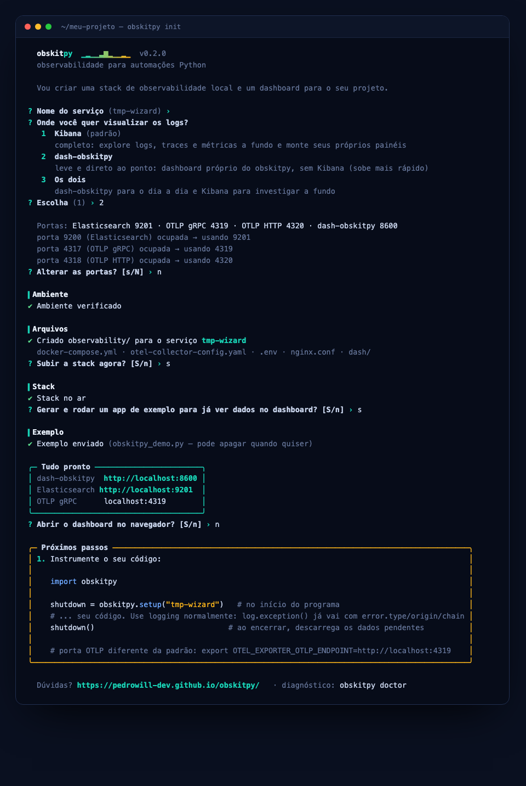
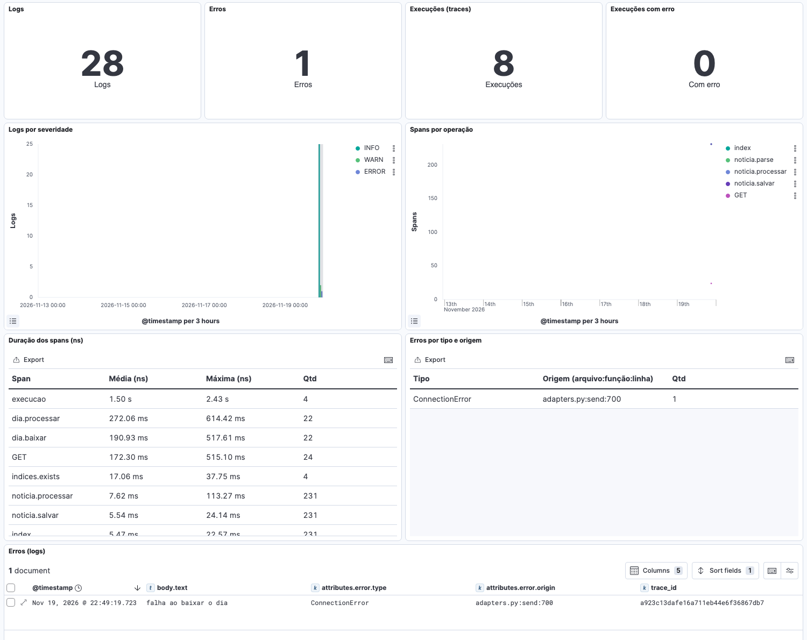

# Início rápido

Objetivo: ver logs, traces e erros do **seu** código num dashboard do Kibana em cerca de 5 minutos.

## 1. Pré-requisitos

- Python 3.10+
- Docker rodando (`docker info` sem erro) com Compose v2 (`docker compose version`)
- Portas livres em `127.0.0.1`: 9200 (Elasticsearch), 5601 (Kibana), 4317 e 4318 (OTLP).
  Se alguma estiver ocupada, escolha outra no `init` (passo 3).

No macOS com Colima: `colima start --cpu 4 --memory 6 --disk 30`.
O projeto precisa estar **dentro do seu `$HOME`** (o Colima só compartilha essa pasta com o Docker).

## 2. Instalar

```bash
cd meu-projeto
uv init && uv add "obskitpy[requests]"      # com uv (recomendado)
# ou: pip install "obskitpy[requests]"
# versão em desenvolvimento: uv add "obskitpy[requests] @ git+https://github.com/pedrowill-dev/obskitpy.git#subdirectory=obskitpy"
```

## 3. Rodar o assistente

> Com uv, prefixe os comandos com `uv run` (ex.: `uv run obskitpy init`); com pip, ative o venv antes.

```bash
obskitpy init
```

O assistente conversa com você, checa o ambiente e faz o resto:



1. **Nome do serviço** (padrão: o nome da pasta).
2. **Onde você quer visualizar os logs?**
   - **Kibana**: completo, para explorar a fundo e montar painéis próprios.
   - **dash-obskitpy**: dashboard próprio, leve e direto ao ponto, sem Kibana (sobe mais rápido).
   - **Os dois**: dash-obskitpy no dia a dia e Kibana para investigar.
3. **Portas**: se alguma estiver ocupada, ele escolhe a próxima livre e avisa.
4. **Subir a stack agora?** Mostra o progresso e espera tudo ficar saudável.
5. **Rodar um app de exemplo?** Gera `obskitpy_demo.py` e o executa, para o dashboard já nascer com dados.
6. **Abrir no navegador?**

Prefere sem perguntas (scripts, CI)? Escolha tudo por flags:

```bash
obskitpy init --service meu-servico --local dash-obskitpy --yes --up --demo
```

Algo falhou? `obskitpy doctor` mostra o que falta (Docker, Compose, memória, portas).
Mais detalhes em [CLI e biblioteca](guia-obskitpy.md) e [dash-obskitpy](dash-obskitpy.md).

## 4. Instrumentar o código

```python
import logging, time
import obskitpy

log = logging.getLogger("pedidos")
shutdown = obskitpy.setup("meu-servico")        # use o mesmo nome do `init`

@obskitpy.traced()
def validar(n):
    if n % 3 == 0:
        raise ValueError(f"pedido {n} inválido")

@obskitpy.traced("processar-lote")
def lote():
    for n in range(1, 10):
        try:
            validar(n)
            log.info("pedido ok", extra={"pedido": n})
        except ValueError:
            log.exception("falha no pedido")
        time.sleep(0.1)

lote()
shutdown()      # sempre chame antes de encerrar: descarrega logs/traces/métricas pendentes
```

> O nome passado a `obskitpy.setup(...)` precisa ser o mesmo do `OBSKITPY_SERVICE` em `observability/.env`,
> pois os painéis filtram por ele.

## 5. Ver o resultado

Rode o script e abra o dashboard com `obskitpy open` (ou o link impresso pelo `up`):

| Você escolheu | Endereço |
|---|---|
| dash-obskitpy | `http://localhost:8600` |
| Kibana | `http://localhost:5601/app/dashboards#/view/<servico>-observability` |



Os primeiros dados levam alguns segundos para ficar pesquisáveis no Elasticsearch — se os painéis estiverem vazios,
aguarde ~30 s e atualize. Confira também a janela de tempo (canto superior direito): o padrão é *Last 24 hours*.

## 6. Próximos passos

- Adicionar painéis próprios e versioná-los: [Dashboards](dashboards.md)
- Métricas de negócio, atributos nos spans, produção de erros: [Guia do obskitpy](guia-obskitpy.md)
- Um projeto real completo: [exemplo das notícias](exemplo.md)
- Algo deu errado? [Solução de problemas](solucao-de-problemas.md)

## Encerrar

```bash
obskitpy down        # derruba os containers e mantém os dados
obskitpy down -v     # derruba e apaga os dados
```
