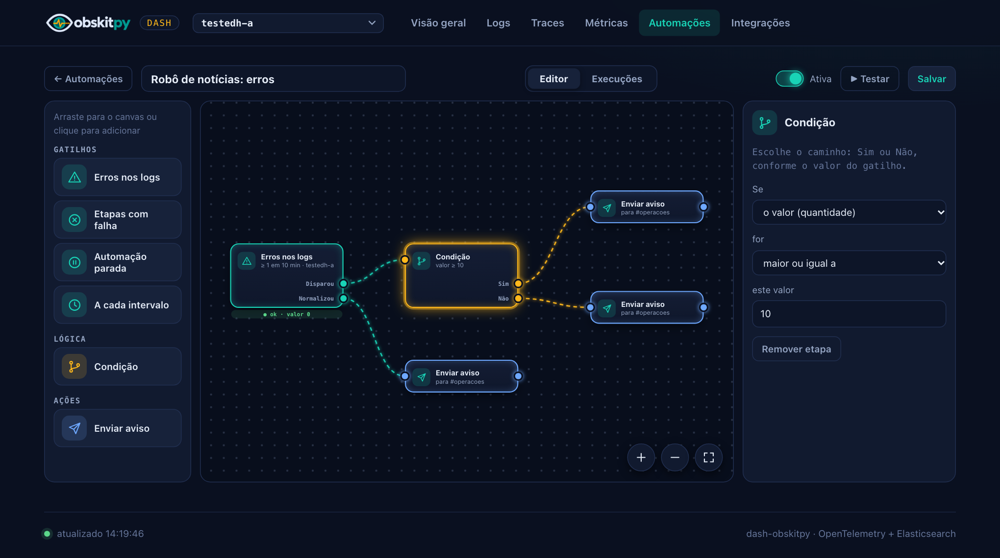
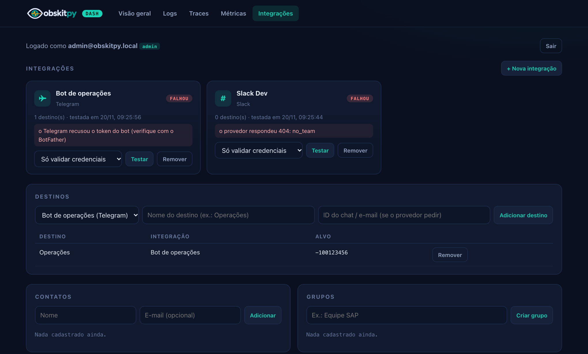
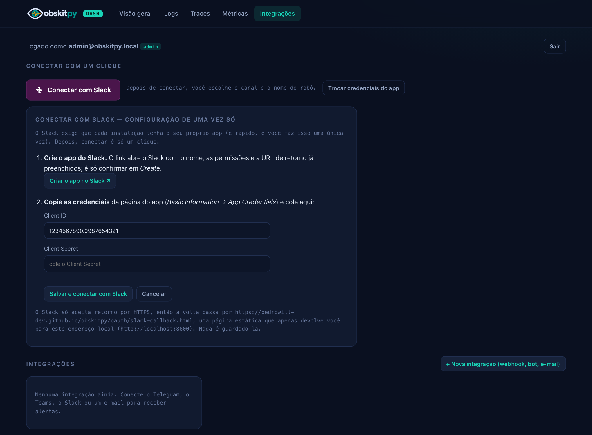

# Portal: integrações e automações

!!! note "O que já existe"
    O portal guarda as **integrações** (Telegram, Teams, Slack, e-mail), cadastra **destinos** e tem um **editor visual
    de automações** (estilo n8n) que reage aos seus logs, traces e métricas. Reconhecimento, escalonamento e
    mais tipos de gatilho e ação vêm nas próximas fases (veja o [roadmap](#roadmap)).





*(Credenciais de teste falsas: por isso as integrações aparecem como "FALHOU", que é o retorno real do provedor.)*

## Ativar

Num projeto que usa o **dash-obskitpy** (`--local dash-obskitpy` ou `ambos`):

```bash
obskitpy portal enable
```

O comando gera os segredos, liga o **PostgreSQL** e a **API do portal** na stack, atualiza o dash e mostra o endereço
e o usuário administrador. A primeira vez baixa as imagens e instala o portal (alguns minutos).

| Resultado | Onde |
|---|---|
| Tela de Integrações | `http://localhost:<DASH_PORT>/#integrations` (aba **Integrações** do dash) |
| API e documentação interativa | `http://localhost:<PORTAL_PORT>/api/docs` (padrão 8700) |
| Credenciais do administrador | `observability/.portal.env` (fora do git) |

`obskitpy portal password` gera uma nova senha para o administrador. Os dados de integrações ficam no volume
`pgdata` da stack; `obskitpy down -v` apaga tudo, inclusive o banco.

## Conectar com Slack em um clique

Na aba **Integrações**, o botão **Conectar com Slack** abre o Slack, você autoriza, e volta para o dash. Depois é só
escolher o **canal** e o **nome do robô** (e o ícone) e usar **Salvar e enviar teste**.



**Na primeira vez** (e só nela) o assistente pede uma configuração de 1 minuto, porque o Slack exige que cada
instalação tenha o próprio *app*:

1. Clique em **Criar o app no Slack**. O link abre o Slack com o nome, as permissões e a URL de retorno **já preenchidos**;
   é só confirmar em *Create*.
2. Copie o **Client ID** e o **Client Secret** (*Basic Information → App Credentials*) e cole na tela. O secret fica criptografado.

Depois disso, **Conectar com Slack** é um clique só. Reconectar o mesmo workspace troca o token e mantém o nome do robô.

| O que você configura | Como funciona |
|---|---|
| **Canal** | A lista vem do Slack (públicos e privados em que o robô está). O robô pode escrever em canais públicos sem ser convidado (`chat:write.public`); em canais privados, convide-o com `/invite`. |
| **Nome e ícone do robô** | Cada mensagem sai com o nome e o emoji que você escolheu (`chat:write.customize`). |

### Por que a volta do Slack passa por uma página no GitHub Pages?

O Slack só aceita URL de retorno em **HTTPS** (`http://localhost` não é aceito). Como o obskitpy roda na sua máquina,
a volta passa por `https://pedrowill-dev.github.io/obskitpy/oauth/slack-callback.html`, uma página **estática** que só
devolve o navegador para o `localhost` de onde você começou e **não guarda nada**. Ela só encaminha para
`localhost`/`127.0.0.1`; o `state` é assinado e expira em 10 minutos pelo seu portal.

Se o seu portal tem um endereço HTTPS próprio, defina `OBSKITPY_PUBLIC_ORIGIN=https://obs.empresa.com` no
`observability/.portal.env`: a volta do Slack vai direto para `https://obs.empresa.com/api/v1/oauth/slack/callback`
e a página do GitHub Pages deixa de ser usada. (Para outro endereço de retorno estático, use `OBSKITPY_OAUTH_RELAY`.)

!!! note "Slack por webhook continua existindo"
    Se você só quer postar num canal fixo, **+ Nova integração → Slack** com um *Incoming Webhook* continua valendo
    e não precisa de app nem de OAuth.

## Como conectar os outros provedores

| Provedor | O que você precisa | Destino |
|---|---|---|
| **Telegram** | Um bot criado no @BotFather (token) | ID do chat (número, ou `@canal`). O bot só escreve para quem já conversou com ele. |
| **Microsoft Teams** | Um *Workflow* do Teams ("Postar em um canal quando uma solicitação de webhook for recebida"); cole a URL gerada | O canal é o do workflow |
| **Slack (webhook)** | Um *Incoming Webhook* do seu app Slack | O canal é o escolhido ao criar o webhook. Para conectar com um clique, veja acima |
| **E-mail (SMTP)** | Servidor, porta, usuário, senha e remetente. No Gmail: `smtp.gmail.com:587` com uma **senha de app** | E-mail do destinatário |

O botão **Testar** valida as credenciais (no Telegram, confirma o token e o nome do bot) e, escolhendo um destino,
envia uma mensagem de teste. O resultado (OK ou o motivo da falha) fica registrado na integração.

### Conexão, destino e contato são coisas diferentes

- **Integração (conexão):** a autorização usada para enviar (um bot, um webhook, um servidor SMTP).
- **Destino:** para onde a mensagem vai (um chat, um canal, um endereço).
- **Contato e grupo:** as pessoas e equipes que recebem (e que poderão ser trocadas sem mexer nas regras).

Essa separação permite que uma regra continue valendo quando o canal ou o responsável mudar.

## Automações

**Integrações** só conectam o obskitpy ao mundo (Slack, Telegram, e-mail…). As **automações** dizem *o que fazer* com
o que os seus robôs registram. Na aba **Automações** do dash você desenha um fluxo, como no n8n:

**Gatilho** (o que observar) → **Condição** (opcional, escolhe o caminho) → **Ação** (o que fazer).

1. Clique em **+ Nova automação** e escolha um modelo pronto (ou comece em branco).
2. **Arraste** etapas da paleta para o canvas (ou clique nelas) e **ligue** puxando a bolinha da direita de uma etapa
   até a esquerda da seguinte. Clique numa etapa para ajustar os campos no painel da direita.
3. **Salvar**, **▶ Testar** e deixe a chave **Ativa** ligada.

| Etapa | Tipo | O que faz |
|---|---|---|
| **Erros nos logs** | Gatilho | Dispara com logs `ERROR`/`CRITICAL` acima do limite na janela; tem as saídas *Disparou* e *Normalizou* |
| **Etapas com falha** | Gatilho | Dispara com spans (traces) de erro acima do limite |
| **Automação parada** | Gatilho | Dispara quando nenhum dado chega na janela (robô travado ou que não rodou) |
| **A cada intervalo** | Gatilho | Executa de tempos em tempos (bom para resumos); o valor é a contagem de erros no intervalo |
| **Condição** | Lógica | Escolhe *Sim* ou *Não* comparando o valor, a janela ou o nome do serviço |
| **Enviar aviso** | Ação | Manda uma mensagem a um destino (canal do Slack, chat do Telegram, e-mail…) |

Nas mensagens você usa variáveis: `{{service}}`, `{{value}}`, `{{window}}`, `{{automation}}`, `{{event}}` e `{{time}}`.
Para erros, há três a mais, preenchidas com o erro mais recente da janela: `{{erro}}` (tipo e mensagem da exceção), `{{origem}}` (arquivo:função:linha) e `{{trace}}` (o traceback Python, limitado às últimas 1500 letras). Sem erro na janela (ex.: “Automação parada”), ficam vazias.

### Explicação do erro por IA (`{{explicacao}}`)

Com uma chave do Gemini, a variável `{{explicacao}}` traz 1 ou 2 frases com a causa provável e o que fazer. Para ligar, coloque em `observability/.portal.env` e rode `uv run obskitpy portal enable`:

```
OBSKITPY_GEMINI_KEY=sua-chave
# opcionais: OBSKITPY_AI_MODEL=gemini-3.5-flash-lite  OBSKITPY_AI_DAILY_CAP=30
```

Feita para gastar o mínimo (uma chamada custa cerca de 300 tokens):

1. **Só se você usar a variável** numa mensagem. Sem `{{explicacao}}`, a IA nunca é chamada.
2. **Cache por erro:** o mesmo erro (tipo + origem, ignorando números e ids) é explicado uma vez e reaproveitado por 7 dias, inclusive nos lembretes e testes.
3. **Entrada mínima:** só a linha do erro e as últimas 6 linhas do traceback (até 600 letras), nunca o log inteiro.
4. **Saída curta:** até ~40 palavras, no máximo 120 tokens, raciocínio mínimo e temperatura 0.
5. **Teto diário** de chamadas (padrão 30, as falhas contam). Passou do teto, o aviso sai igual, sem a explicação.
6. **Falhou, não insiste:** espera 10 minutos antes de tentar de novo.

**Como roda:** o portal avalia os gatilhos a cada 30 s consultando o Elasticsearch. Quando o gatilho estoura, ele
percorre o fluxo a partir da saída *Disparou*; se continuar estourado, repete só depois do tempo de "relembrar"
(0 = nunca); quando volta ao normal, percorre a saída *Normalizou*. Cada gatilho mostra no canvas o estado ao vivo
(`● ok · valor 0`, `● disparado`) e a aba **Execuções** guarda o resultado de cada etapa. Se o Elasticsearch ou um
destino falhar, o motivo aparece e o restante do fluxo continua.

**Testar** roda o fluxo agora de verdade: os avisos são enviados (com `[Teste]` no título) e cada etapa mostra ✓ ou ✗.

!!! note "Quem pode o quê"
    Administradores criam e editam; operadores testam; visualizadores só olham.

## Segurança

| Proteção | Como |
|---|---|
| Segredos (tokens, URLs de webhook, senhas) | Criptografados no banco (Fernet) e **nunca** devolvidos pela API: só aparece o nome do campo guardado |
| Navegador | Sessão em cookie `HttpOnly` + `SameSite=Strict`; ações que alteram dados exigem o cabeçalho `X-Obskitpy-Csrf` |
| Perfis (RBAC) | **viewer** lê; **operator** também testa integrações; **admin** cria, altera e remove, gerencia usuários e vê a auditoria |
| Webhooks | Só `https` e só os domínios do provedor (`hooks.slack.com`, `*.logic.azure.com`...). Endereços que resolvem para a rede interna são **bloqueados** (SSRF) |
| Login | Senhas com scrypt; limite de 5 tentativas por minuto por e-mail e IP |
| Erros dos provedores | Os segredos são mascarados antes de gravar ou mostrar qualquer erro |
| Auditoria | Cada ação (login, criar/alterar/remover, teste) fica registrada com autor e horário |

!!! warning "Uso local"
    Como o resto da stack, o portal é publicado só em `127.0.0.1` e usa HTTP. **Não o exponha na internet** sem um
    proxy com HTTPS na frente (e `OBSKITPY_COOKIE_SECURE=1`). O Elasticsearch continua com a segurança desligada.

## API

Documentação interativa em `/api/docs`. Rotas principais:

| Rota | Perfil | O que faz |
|---|---|---|
| `GET /api/v1/health` | — | Saúde do portal e do banco |
| `POST /api/v1/auth/login` · `logout` · `GET /auth/me` | — / logado | Sessão |
| `GET /api/v1/integrations/kinds` | logado | Catálogo de provedores e campos |
| `GET/POST/PUT/DELETE /api/v1/integrations` | viewer / admin | Conexões com os provedores |
| `POST /api/v1/integrations/{id}/test` | operator | Valida e, com `destination_id`, envia uma mensagem de teste |
| `GET/POST/DELETE /api/v1/destinations` | viewer / admin | Destinos |
| `GET/POST/DELETE /api/v1/contacts` · `/contact-groups` | viewer / admin | Contatos e grupos |
| `GET/POST/PUT/DELETE /api/v1/automations` | viewer / admin | Fluxos de automação (grafo de etapas) |
| `GET /api/v1/automations/nodes` | logado | Catálogo de etapas, campos e variáveis |
| `POST /api/v1/automations/{id}/test` | operator | Roda o fluxo agora |
| `GET /api/v1/automations/runs` | logado | Histórico de execuções |
| `GET/POST/DELETE /api/v1/users` | admin | Usuários |
| `GET /api/v1/audit` | admin | Auditoria |

## Modelo de dados

`users`, `provider_connections`, `notification_destinations`, `contacts`, `contact_groups` (com as tabelas de ligação) e
`oauth_apps`, `automations`, `automation_runs` e
`audit_events`, em PostgreSQL via SQLAlchemy.

## Roadmap

Planejado, **ainda não implementado** (o editor visual de fluxos e o motor de gatilhos já existem):

| Fase | Entrega |
|---|---|
| 2. Envio | Templates de mensagem, workers com retentativa e deduplicação, histórico de entregas |
| 3. Mais gatilhos e ações | Gatilhos por métricas e por assinatura de erro; ações de webhook, e-mail em lote e espera |
| 4. Operação | Reconhecimento, escalonamento, silêncio e recuperação |
| 5. Multicanal | Conexão por OAuth do Gmail e Teams via Graph (o Slack por OAuth já está disponível) |
| 7. Inteligência | Sugestão de causas e roteamento |

Um ponto a resolver antes das regras: hoje "Execuções com erro" pode ficar em zero mesmo com um `ConnectionError` registrado
(erro tratado dentro da execução). O motor de alertas precisará distinguir **erro registrado**, **span com falha** e
**resultado final da execução**.

## Solução de problemas

- **A aba Integrações diz que o portal não está ativado:** rode `obskitpy portal enable` (e `obskitpy up` se a stack estiver parada).
- **O portal demora a subir na primeira vez:** ele instala o pacote dentro do container; acompanhe com
  `docker compose -p obskitpy-<servico> logs -f portal`.
- **Slack — `redirect_uri_mismatch`:** o app foi criado sem o manifesto. No app do Slack, em *OAuth & Permissions → Redirect URLs*, adicione a URL mostrada na tela de configuração.
- **Slack — `not_in_channel`:** o canal é privado e o robô não entrou: no Slack, `/invite @nome-do-robo`.
- **Slack — `invalid_auth` / `token_revoked`:** o acesso foi removido no Slack; clique em **Reconectar**.
- **Esqueci a senha:** `obskitpy portal password`.
- **"OBSKITPY_SECRET_KEY ausente":** o `observability/.portal.env` foi apagado. Rode `obskitpy portal enable` de novo
  (atenção: novos segredos não conseguem ler integrações guardadas com a chave anterior).
