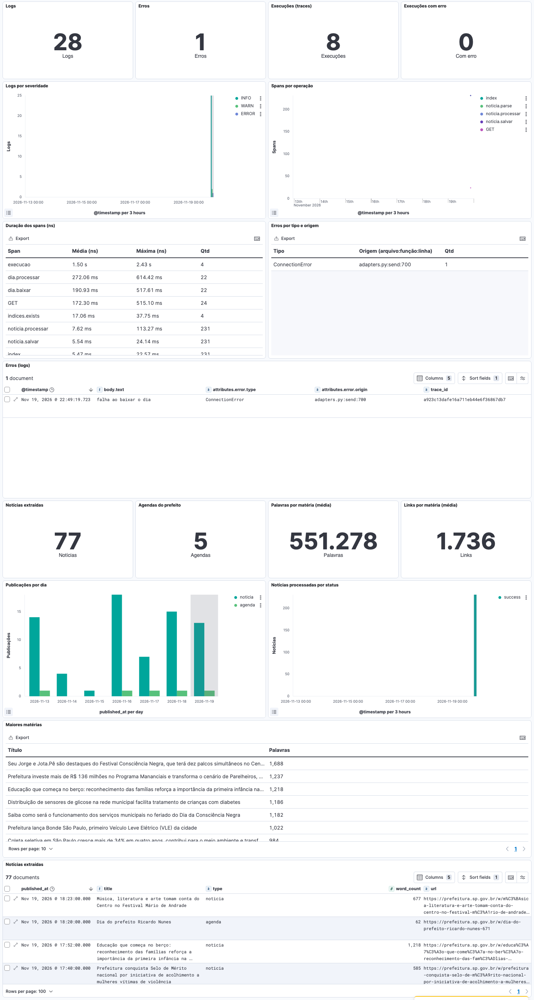

# Notícias da Prefeitura de SP com observabilidade (exemplo do obskit)

Robô que extrai as notícias de https://prefeitura.sp.gov.br/noticias, grava no Elasticsearch (índice `noticias-sp`)
e mostra tudo num dashboard do Kibana: dados extraídos **e** saúde do robô (logs, traces, métricas, erros).
Serve de exemplo de como plugar o [`obskit`](../obskit/README.md) num projeto Python.



## Como os dados são obtidos

A lista "Todas as notícias" da página é montada no navegador por JavaScript, então o HTML da página vem sem notícias.
O robô chama a mesma API pública do portal (Liferay) que o JavaScript chama, um dia por vez
(`/o/headless-delivery/v1.0/content-structures/79914/structured-contents`, filtrando por `siteId` e `datePublished`).
Cada item vira um documento com: título, URL, data de publicação/modificação, resumo, texto completo, nº de palavras,
links, imagens, categorias, palavras-chave e tipo (`noticia` ou `agenda` — a "Dia do prefeito" é a agenda diária).
O id do documento é o id da Prefeitura, então rodar de novo **atualiza** em vez de duplicar.

> Use com moderação: são ~7 requisições por execução. Se o portal mudar a estrutura, o `ParseError` aparece no dashboard.

## Rodar

```bash
python3 -m venv .venv && .venv/bin/pip install -r requirements.txt   # instala o obskit local + dependências
.venv/bin/obskit up                                                   # stack + dashboard (1ª vez ~1 min)
.venv/bin/python -m noticias_sp                                       # extrai os últimos 7 dias
```

Dashboard: http://localhost:5601/app/dashboards#/view/noticias-sp-observability?_g=(time:(from:now-7d,to:now))

| Variável | Padrão | |
|---|---|---|
| `DIAS` | `7` | quantos dias para trás (contando hoje) |
| `RPA_INTERVAL_SECONDS` | `0` | `0` = roda uma vez; `>0` repete a cada N segundos |
| `ELASTICSEARCH_URL` | `http://localhost:9200` | |

Parar: `.venv/bin/obskit down` (`-v` apaga os dados).

## O que o obskit trouxe

Foi preciso só isto no código ([`noticias_sp/__main__.py`](noticias_sp/__main__.py)):

```python
shutdown = obskit.setup("noticias-sp")        # logs + traces + métricas
tracer = obskit.tracer("noticias_sp")         # spans: execucao > dia.processar > dia.baixar | noticia.processar > parse/salvar
processed = obskit.meter(...).create_counter("noticias.processadas")   # métrica própria, por status
log.exception("falha ao processar notícia")   # já sai com error.type / error.origin / error.chain
```

Os painéis do topo do dashboard (logs, erros, execuções, duração dos spans, erros por tipo/origem, lista de erros com `trace_id`)
vêm do `obskit init`. Os de baixo (notícias extraídas, publicações por dia, maiores matérias, tabela de notícias,
notícias por status) são deste projeto: [`observability/extend_dashboard.py`](observability/extend_dashboard.py).

## Evoluir o dashboard

```bash
# edite observability/extend_dashboard.py (listas VISUALIZATIONS / SEARCH) e:
.venv/bin/python observability/extend_dashboard.py && .venv/bin/obskit dashboard apply
```

Prefere montar no Kibana? Crie os painéis lá, rode `obskit dashboard export` e versione o `dashboard.ndjson`
(neste caso não rode mais o `extend_dashboard.py`, que regera o arquivo do zero).

## Testes

```bash
.venv/bin/pytest -q      # parser com itens reais da API (tests/items.json)
```

## Limitações conhecidas

- As notícias não trazem categorias na API (`categories` vem vazio); por isso não há painel por categoria.
- O painel "Execuções com erro" só conta falhas que derrubam a execução inteira; falhas por dia/notícia são tratadas e aparecem em "Erros".
- O horário de publicação é gravado em UTC; o robô consulta os dias no fuso de São Paulo (-03:00).
